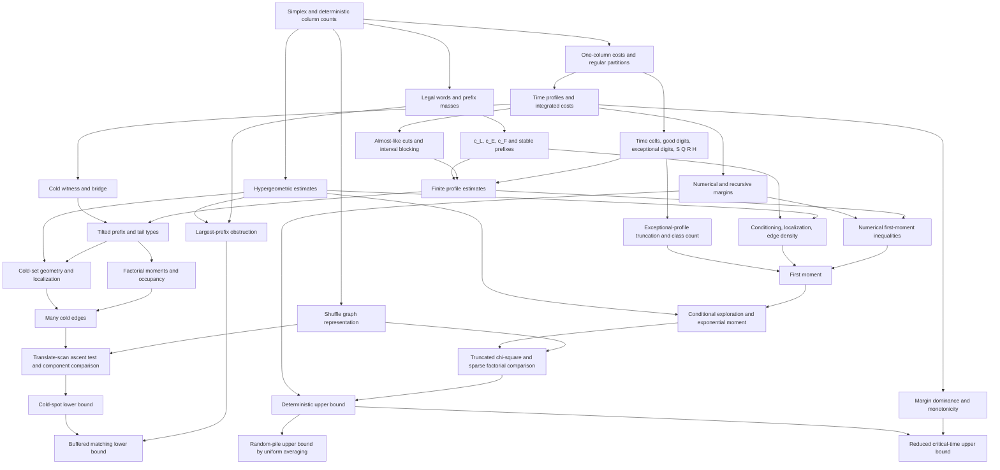

# Proof structure and dependency ledger

Mathematical sources are restricted to `time_inhomogeneous_riffle_shuffle_unified_article.tex`, `2103.05068v3.pdf`, and `2510.22783v1.pdf`. This file describes the proof claimed by the sources; a dependency arrow is not a certification that its target has been proved in Lean. Library source is consulted only to implement trusted Lean/mathlib interfaces.

The TeX contains a commented-out lower-bound overview (lines 2564–2785). It is historical material, not an additional active proof. The active lower bound starts at line 2788. The two definitions of the numerical first-moment margin agree. For the ambient exponent, the later definition at line 490 uses the exact prefix length; it supersedes the earlier shorthand involving `floor(r log N)`.

Classification: **F** finite/discrete mathematics; **P** probability on finite shuffle spaces; **A** real analysis, entropy, logarithmic estimates, optimization, or asymptotics; **M** measure theory/integration/conditional expectation. Mixed labels indicate genuine interfaces.

## Architecture



## Foundational definitions

| Definition / source location | Immediate dependencies | Kind |
|---|---|---|
| `D_k`, deterministic pile counts, `p^(j)` (86–103) | `k≥2`, natural counts summing to positive deck size | F |
| Shuffle law, uniform law, TV, mixing time (103–110) | permutations, finite uniform interleavings, products of transition kernels | F/P |
| Integer-path edges/boundary, falling factorials (111–122) | finite sets / integers | F |
| `log_N`, bounded-in-probability notation (123–125) | `N>1`, logarithms, probability law | A/P |
| `p_max`, `a_p`, `psi_p(theta)` (126–134) | simplex, finite maximum, real powers/logarithm | F/A |
| Tilted law, `I_p`, `H_p` (135–147) | positive power sum; zero-coordinate conventions | F/A |
| `a(t),psi_t,I_t,H_t` and `A,B,J` (148–171) | probability measures on the simplex, measurability/integrability of time dependence | A/M |
| Global beta and four Lambda margins (176–208) | integrated costs, real infima/suprema on compact parameter domains | A |
| Upper critical times (209–233) | margins, infimum of negativity times | A |
| Almost-time-profile-like cuts (249–263) | Borel partition, closed rho-grid interval counts, time integrals of cell masses | F/A/M |
| Randomized time-profile-like cuts (265–274) | probability on pile sequences, quantified high-probability almost-like event | P/M |
| Chi-regular partition (276–303) | Borel cells and representatives, uniform psi/max/log coordinate control | F/A/M |
| Good columns and local good-shuffle condition (305–309) | two distinct masses at least chi, interval counts | F/A |
| Local beta, `N_1,N_2,N_3`, FM (331–364; 749–786) | integrated costs, infimum over `[3,4]`, ordered times | A |
| Accessible blocks, RFM (366–373) | conditional exploration, FM for every accessible block | P/A/M |
| Shuffle matrix, sorted strings, graph density (386–400) | finite fixed-count column law, independent copies, permutations | F/P |
| Local sparsity (424–427) | finite path subgraphs | F |
| Legal word tree, prefix cylinders, parent, interval, common edges (445–476) | positive selected counts, finite words, sorted rows | F/P |
| Parameter hierarchy (477–488) | nested choices then uniform final `N` limit | A |
| Ambient block, exact `c_L`, `c_E` (490–519) | fixed legal prefix, exact birth length, prefix mass, bounded tail costs | F/A/P |
| Left/right boundary indices and first-crossing families (521–591) | chi `<1/k`, finite large-pile indices, legal prefixes, terminal fallback | F |
| Admissible boundary families, compatible pair, join (592–614) | small-pile digit counts, prefix comparison | F/A |
| Lexicographic side pieces and `c_F` (615–660) | prefix cylinder masses; empty maximum `0`; logarithm of `0` represented by minus infinity | F/A/P |
| Retained, terminal, fluctuation-regular pairs (661–672) | boundary crossings, finite vs bottom fluctuation exponent | F/A |
| Gamma, Lambda, stable family (673–697) | parent, `c_L`, constant pair `c_F`, threshold, terminal fallback | F/A |
| Space-time profile and `S_x,Q_x,R_x,H_x` (699–747) | time-cell partition, simplex-cell partition, good/exceptional digits, finite counts | F/A |
| Labelled survivor sets, residual conditional counts (2915–3016, 3031–3051) | independent uniform column multisets, fixed row prescriptions | F/P |
| Lower-bound witness functionals `F,h,Gamma` (3430–3496) | beta, integrated tilted costs and entropy | A/M |
| Truncated tilted cell laws (3800–3845) | representatives, positive good-digit support, normalization, rounding | F/A |
| Collision-likely prefix class and relative cold set (3847–3883) | typed suffixes, product masses, lexicographic endpoints, integer intersection | F/A |
| Bridge word, remaining tail columns, tail type family (4004–4078) | two good columns, maximal remaining digits, typed tail law | F/A |
| Full collision-likely strings and collision count (4080–4093) | ambient prefix, cold prefix, bridge, tail; occupancies | F/P |
| Uniform translate-scan ascent event (4899–4925) | translates of a deterministic integer set, uniform permutation ascents | F/P |

## Active upper-bound results

The source label uniquely identifies each row. Dependencies include semantic uses that are not written as LaTeX references.

| Source label | Immediate inputs / results | Kind |
|---|---|---|
| `lem:ub-graph-representation` | fixed-count shuffle law, uniform permutation; 2510 Proposition 2.2 | F/P |
| `lem:ub-truncated-chi-square` | graph representation, finite densities, Cauchy–Schwarz, truncation | F/P/A |
| `lem:ub-sparse-factorial` | local sparsity, component density formula; 2103 Section 3 / 2510 Lemma 3.5 | F/P |
| `lem:ub-stable-partition` | legal tree, monotonicity of c_L, constancy of c_F after the join, stopping definition | F/A |
| `lem:ub-global-boundary-decomposition` | first-crossing uniqueness, stable partition, admissibility | F |
| `lem:ub-regular-partition-interval-blocking` | regularity, almost-like grid condition, interval covering, integral additivity | F/A/M |
| `lem:ub-profile-estimates` | exact cost splitting, regular partition/blocking, maximal-pile bound, side-mass lower bound, parent crossing, entropy inequality | F/A/M |
| `lem:ub-bad-profile-reduction` | small-pile bounds, binomial tail/count estimates, expected cylinder mass, nested quantifiers | F/P/A |
| `lem:ub-hypergeometric-estimates` | one-column finite sampling without replacement, concentration and point-mass estimates | F/P/A |
| `lem:ub-ambient-conditioning-transfer` | hypergeometric estimates, conditioning on ambient rows, representative replacements | P/A/M |
| `lem:ub-ambient-concentration-anti-concentration` | hypergeometric estimates, lexicographic side pieces, c_F, ambient conditioning | P/A/M |
| `lem:ub-per-edge-stable-localization` | stable partition, concentration/anti-concentration, finite prefix branches | F/P/A |
| `lem:ub-edge-density-bounds` | tail pair-collision probability, profile estimates, stable localization, concentration/anti-concentration | F/P/A |
| `lem:ub-terminal-singleton-bound` | terminal tail factor 1, expected edge count bounded by occupancy; terminal size bound | F/P/A |
| `lem:ub-numerical-lemma` | FM, finite profile estimates, stable/parent crossing, finite c_F comparison, separate terminal case | A |
| `prop:ub-first-moment` | boundary decomposition, bad-profile reduction, localization, entropy class count, density bounds, numerical lemma | F/P/A |
| `lem:ub-conditional-preservation` | revealed-row conditional law, hypergeometric concentration, accessible size bound | P/M/A |
| `lem:ub-conditional-first-moment` | conditional preservation, recursive FM, first moment, controlled number of ambient blocks | F/P/M/A |
| `lem:ub-portenko-exponential-moment` | directional exploration, uniform conditional first moment, iterative conditional exponential bound | P/M/A |
| `lem:ub-shared-edge-exponential-moment` | covering by 2k directional explorations, directional exponential bounds, convexity | F/P/A |
| `lem:ub-regularity-sparsity` | prefix concentration, stable-block estimates, union bounds | F/P/A |
| `thm:deterministic-upper-bound` | graph representation, truncation, sparse factorial bound, shared-edge exponential moment, regularity/sparsity | P/A |
| `cor:random-time-profile-upper-bound` | deterministic bound **uniform in the cuts**, high-probability good event, convexity of TV under mixing | P/M/A |
| `lem:buffered-pointwise-upper-bound` | cost additivity, global-to-local beta identity, accessible exponent error, coefficients ≤7/2 and ≤3/2, deterministic upper bound | A/P |
| `lem:upper-margin-monotonicity` | nonnegative costs, interval additivity, old/new optimization-domain cases | A/M |
| `cor:full-margin-critical-upper-bound` | buffered upper bound, monotonicity, definition of critical time | A/P |
| `lem:basic-one-column-inequality` | sum p=1, coordinate maximum, power monotonicity, logarithm; integration for its averaged consequence | F/A/M |
| `thm:dominance-reduction` | basic inequality at theta=2,3, nonnegative A, additivity, evaluation at theta=3 | A |
| `cor:buffered-consequence` | dominance reduction, definition of max | A |
| `thm:upper-critical-reduced` | dominance, full-margin critical theorem, mixing-time definition | A/P |

## Active lower-bound results

| Source label | Immediate inputs / results | Kind |
|---|---|---|
| `lem:successive-thinning-tail` | labelled survivor process, residual fixed counts, negative dependence / exponential bound | F/P/A |
| `cor:iterated-hypergeom` | one-step concentration, successive-thinning tail, prefix family polynomial size, induction/union bound | F/P/A |
| `prop:largest-prefix` | maximal-pile product, integrated A estimate, iterated thinning, increasing-run test under uniform permutations | F/P/A |
| `lem:entropy-ineq` | finite tilted law, relative entropy, derivative variance identity, square-of-power-sum comparison | F/A |
| `lem:bridge-window` | local good columns, bounded one-column costs, interval endpoint displacement | F/A/M |
| `lem:cold-witness` | positive Lambda_1, small Lambda_0, entropy inequalities, minimization in theta, bridge window | A/M |
| `lem:type-estimates` | regular cells/blocking, truncated tilted law, Stirling/multinomial estimates, rounding error | F/A/M |
| `lem:cold-geometry` | type estimates, disjoint relative cylinders, integer rounding, cold-witness entropy gap | F/A |
| `lem:tail-types` | type-estimate argument on unreserved tail columns; bridge deletion cost | F/A/M |
| `lem:uniform-endpoint-theorem` | lexicographic decomposition into sibling cylinders, iterated thinning, polynomial family bound | F/P/A |
| `lem:endpoint-control` | uniform endpoint theorem, cold witness | P/A |
| `lem:bridge-buffers` | two good bridge columns, cold-witness gap, maximal-pile bridge choices | F/A |
| `lem:localization` | endpoint control, bridge buffers, iterated thinning; simultaneous event | F/P/A |
| `lem:fixed-column-factorial` | exact fixed-column factorial identity, legal positive masses, falling-factorial approximation | F/P/A |
| `lem:conditional-factorial` | exact residual counts, fixed-column factorial argument, bounded conditioned rows | F/P/M/A |
| `lem:central-window` | factorial moment assumptions, truncated inclusion–exclusion, Poisson generating functions | F/P/A |
| `lem:two-category-poisson` | fixed/conditional factorial estimates, thinning tail, central-window comparison; small/central/large mean regimes | F/P/A |
| `lem:occupancy` | full-word type mass, bridge loss, witness bound, two-category Poisson lemma | F/P/A |
| `lem:cold-collision-count` | occupancy expectation/variance, cold geometry, witness gap, Chebyshev | P/A |
| `lem:many-edges` | collision count, localization, distinct full strings give distinct edges | F/P/A |
| `lem:uniform-ascent` | parity-separated disjoint pairs, uniform random permutation, concentration, union over translates | F/P/A |
| `lem:block-bd` | finite random value-set partition, bounded-difference martingale argument | F/P/M/A |
| `lem:permutation-bd` | block bounded differences, component incidence/size accounting | F/P/A |
| `lem:lalley-comparison` | component-wise sorted permutation, expected ascent gain, permutation bounded differences | F/P/A |
| `lem:lalley` | uniform ascent test, component comparison, graph representation, conditional uniform permutation | F/P/M/A |
| `prop:cold-lower` | cold witness, geometry, many edges, Lalley test | P/A |
| `thm:buffered-reduced-lower-bound` | largest-prefix lower bound or cold-spot lower bound, threshold dichotomy | P/A |

## Random-pile extension and limits of the map

The active TeX explicitly states the random-pile **upper** extension. Its finite quantitative core is `TV(mixture,uniform) ≤ sup_good TV(conditional,uniform) + Pr(not good)`. Thus both error terms can be bounded by epsilon/2. No independence of the successive random pile vectors is needed for this transfer. Randomized almost-likeness alone does not supply the local good-shuffle event; that event is separately assumed in the corollary.

The homogeneous paper 2510 Section 3.3 obtains the almost-like event from randomized-mu-like convergence; Section 6 uses tests uniform over admissible cuts for its random-pile lower bound. The active inhomogeneous TeX does **not** state a corresponding random lower-bound theorem. Deterministic conditional TV distances tending to one cannot in general be averaged into a TV lower bound: one needs a common separating event or a uniformly controlled scan family. This missing transfer is an obligation, not a consequence inserted into the map.

## Audit findings relevant to this layer

1. Time measurability of the family of measures is unstated. No integral approximation may be certified by silently replacing that family with a probability kernel.
2. The exact finite times are `M_w/log N` and `floor(T log N)/log N`. The former need not equal r, and the latter need not equal T. Keep explicit displacement errors.
3. Omitting or adding a bounded number of arbitrary legal digits need not produce an o(1) exponent error: a mass 1/N contributes exactly 1 to normalized logarithmic cost.
4. The unified profile contains exceptional positions but omits exceptional digit labels; Q_x is not determined by that profile. Definition 4.7 in 2510 retains position–digit pairs. Wordwise definitions/estimates are valid; constancy on the coarser classes is not assumed.
5. The unified c_F includes the first deterministic column. In three equal deterministic piles, the middle first digit crosses both boundaries and gives positive side-mass c_F, although the left endpoint of the continuation with all later digits zero is deterministic. Thus c_F is a valid defined side-mass exponent, but the stated later anti-concentration claim is not certified. The old homogeneous definition excludes that deterministic initial column.
6. In fixed-cell error estimates the number of cells must remain visible (for example, a sum of cell discrepancies costs a factor equal to the cell count). A constant suppressed as O(phi) may depend on chi through this number. Uniform chi limits require the nested parameter order.

Independent reports and the frozen contract record which parts are implemented and which remain open. No result outside the assigned layer is imported as an unproved Lean theorem.

## Formalized one-sided route to the numerical lemma

The additional frozen contract preserves the literal arbitrary TimeLaw and all existing costs. Its route uses only the inequality directions needed by `lem:ub-numerical-lemma`. It does not certify the manuscript's two-sided profile claims or the lower-bound uses of those claims.

```text
P.measurable_classify + probability measure at each fixed time
    -> C01 measurable fibers, mass sum=1, pointwise cost majorant       [F/M]
finite measure + integrable-index subset constructed inside proof
    -> C02 totalized-integral upper envelope                          [F/M/A]
N>=2 + K=floor(T log N) + literal closed-grid AlmostLike
    -> C03 exact half-open lattice counts and endpoint error          [F/A]
C01 + C02 + C03 + full-block geometry
    -> C04 one-sided quadrature with explicit E                       [F/M/A]
C04 + word/time-set comparison + D11/D12
    -> C05 actual cE, maximal-prefix, terminal and entropy bounds      [F/M/A]
C05 + D08/D10 + B04 + literal FM + numerical N05--N09
    -> C06 source-data numerical margins and terminal exclusion       [F/A]
small chi + fixed finite cell count + rho/phi choices + large N
    -> C07 quantified thresholds and simultaneous numerical budgets  [A]
C06 + C07 + already supplied ambient-error control
    -> uniform source-facing numerical implication                   [F/A/M]
```

No probabilistic independence or time measurability is used by C01--C07. Every grid/cell cardinality remains visible in E. Auxiliary times `max(r,v/L)` and `max(r,n/L)` select ordered arguments of the existing universal FM condition; they do not change any word's physical time. Terminal exclusion uses a separate quadrature estimate directly on `(r,T]`.

The two-sided cost quadrature, ordinary time-integral existence and downstream cF anti-concentration are separate issues. The one-sided route must not be used to infer them. Expected-count identification is handled by the separate frozen finite-probability interface below. Implementation status is recorded in the package README and verification manifest, rather than inferred from this dependency diagram.

## Exact expected-count interface

The source chooses uniformly among all labelled matrices with the prescribed column counts. The P01–P08 contract represents exactly that finite set as a dependent product of column-assignment types. It constructs nonemptiness from the column-count sums and proves the probability facts; it does not posit those facts as fields.

```text
Cuts.sum_count + finite sigma/cardinality equivalence
    -> P01 nonempty exact column assignments and uniform matrix law   [F/P/M]
P01 + row-permutation equivalence + deterministic count conservation
    -> P02 column labelled-row marginal                              [F/P]
P01 + finite product-of-sums and product-cardinality identity
    -> P03 uniform column factorization                              [F/P]
P02-column + P03
    -> P02 full-matrix labelled-row marginal                          [F/P]
P02-column + P03 + finite linearity over row labels
    -> P04 expected box occupancy                                    [F/P]
P04 + singleton/full allowed sets + exact finite prefix split
    -> P05 ambient prefix expectation and P06 left/right expectations [F/P]
P05 + D04
    -> exact cL identity for the logarithm of expected prefix size    [F/P/A]
P06 + the unchanged finite maxima/square roots/extended logarithms
    -> P07 expected-side interpretation of cF                         [F/P/A]
finite reindexing of arbitrary row predicates
    -> P08 cardinality invariance for sample-dependent permutations   [F]
P08 + P05/P06
    -> prefix/side expected counts after a sorting permutation        [F/P]
```

No row independence is used. P02 refers to unsorted labelled rows. P08 proves count invariance pointwise for any permutation, including a sample-dependent sorting permutation; it does not assert invariance of the full matrix law. Prefix and side expectations are unconditional global counts restricted by the ambient prefix. Future side digits are free. P07 keeps maximum and square root outside expectation and preserves zero/empty cases in `WithBot ℝ`.

For the implemented declarations, `DEPENDENCIES.md` and `dependencies.json` give the exact dependency edges extracted from compiled Lean types and bodies. The tables above classify and map the original paper's broader proof; compiled declaration dependencies do not certify unimplemented downstream nodes.
