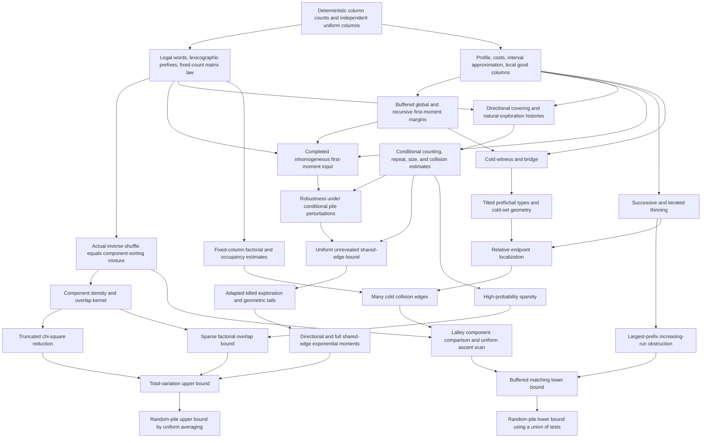

# Remaining upper bound: proof structure and implementation gate

Status: **pre-freeze; no new Lean declarations; upper bound not proved**.

The mathematical sources are exactly `time_inhomogeneous_riffle_shuffle_unified_article.tex`, `2103.05068v3.pdf`, and `2510.22783v1.pdf`. The manuscript's lines 2562–2785 are inside a `comment` environment. Its old lower-bound overview is therefore distinguished from the active matching lower bound beginning at line 2791.

The first-moment proposition at manuscript line 1817 is the intended mathematical input. Its completed model-specific Lean declaration has not been located. Since the initial inventory, concrete matrix/graph foundations and first-moment support modules have appeared. The root independently recompiled the existing sources and audited 74 foundation declarations under Lean 4.33.1 and 29 scalar/counting/aggregation declarations under Lean 4.19.0; all audit results use only standard Lean axioms. The strongest aggregation theorem still assumes localization and class-density estimates. It does not supply the source first-moment proposition. See `audit/INPUT_REVALIDATION.md` for the three-reviewer comparison and exact build evidence.

## Whole proof

The arrows through robustness, conditional counting, and exponential moments are **proof obligations**, not assumed facts. In particular there is no arrow directly from the unconditional first-moment theorem to the exponential moment.

## Definition dependencies

| Object | Data and prerequisites | Source |
|---|---|---|
| Fixed cut sequence | Natural counts `n(j,l)`, sum `N` in every column; zeros allowed | Common setup, lines 88–110 |
| Actual shuffle law | Uniform interleavings of the fixed consecutive piles, with explicit composition convention; inverse taken afterward | 2025 §2.2, Proposition 2.2 |
| Matrix law | Uniform law on each column's fixed-count fiber; product across columns | Lines 388–395, 443–451 |
| Legal words and prefix cylinders | Positive count at every chosen digit; prefix relation; finite lexicographic order | Lines 445–464 |
| Prefix mass and interval | Product of column proportions; sorted-row interval and its endpoints | Lines 445–489; 2025 equations (2.13)–(2.15) |
| Graph | Edge index `i` means equality of sorted rows `i` and `i+1` | Lines 390–395, 467–483 |
| Components and component sorting | Maximal intervals connected by present path edges; ascending values within each interval | Lines 395–400; 2021 §3.1 |
| Density and overlap | Density of component sorting relative to uniform; average of the product of two densities | Lines 395–400 |
| One-column costs | `a(p)`, `psi(p,theta)`, tilted law, cost and entropy | Lines 125–147 |
| Profile integrals | Time profile and integrability of the bounded cost functions; absolute-time integrals `A`, `B`, `J` | Lines 148–170 |
| Almost profile-like cuts | Chosen finite Borel partition and time grid; cell counts | Definition at line 249 |
| Random profile-like cuts | A law on valid deterministic cut arrays; high-probability almost-like event | Definition at line 265 |
| Regular partition | Representatives, cost oscillations, controlled positive coordinates, exceptional coordinates | Definition at line 276 |
| Local good columns | At least two coordinates above the threshold; density in every specified macroscopic interval | Definition at line 305 |
| Ambient exponent | Fixed legal prefix, absolute birth time, expected size measured in the original `N` | Definition at line 490 |
| First-moment margins | `beta(r,b;s)`, all three numerical expressions, positive buffer | Definition at line 331 |
| Recursive margin | First-moment margins for every actually accessible ambient state | Definition at line 366; accessibility must first be made precise |
| Stable boundary families and blocks | Ambient prefix, left/right significant digits, first crossings, fluctuation scales | Definition at line 521 |
| Space-time digit profiles | Stable blocks, time cells, simplex cells, exceptional-digit truncation | Definition at line 699 |
| Numerical first-moment margin | Ambient exponent and profile costs/entropy | Definition at line 749 |
| Local sparsity | Each interval of `L` vertices has at most `L/3` edges; `L` is an integer at least 10 | Definition at line 424 |
| Directions | Initial-pile index and left/right lexicographic cutoffs using nearby good columns | 2025 Definitions 3.6–3.8; not defined in the manuscript |
| Exploration history | Revealed sorted strings within one initial pile, independently for the two matrices | 2025 equation (5.2) |
| Refined conditional state | Natural history plus prefix intervals and all remaining within-block column counts | 2025 Lemmas 5.6–5.11 |
| Typical event | Single-matrix event consisting of direction regularity, adapted conditional-good events and sparsity | 2025 Lemma 3.11; manuscript notation needs disambiguation |
| Cold witness | Positive reduced margin, ambient maximizing prefix, times, tilt, bridge and buffers | Lines 3430–3800 |
| Cold prefix/full-word classes | Tilted cellwise digit types, exceptional-coordinate restrictions, bridge strings | Definitions at lines 3847 and 4080 |
| Cold-set family and scan | Relative deterministic intervals translated inside the deck; boundary and size bounds | Lines 3928–4003, 4899–4949, 5115–5163 |

All probability laws for the finite shuffle can be represented by finite sums in Lean. Conditional estimates can then be stated on positive-mass history fibers, or without division after multiplying by the history-fiber mass. This avoids any ambiguity about null histories. A separate proof must connect that finite representation to the actual shuffle law; defining the shuffle law to be the graph mixture would not prove the representation theorem.

## Assigned upper-bound lemma families

| ID | Statement to establish | Direct dependencies | Inhomogeneous work |
|---|---|---|---|
| G1 | Fixed column law is invariant under row permutations; columns are independent | Fixed-count matrix model | None beyond arbitrary column counts |
| G2 | Refining sorted prefixes with a new independent fixed-count column gives the correct recursive shuffle law | G1; actual shuffle composition | Fix chronology and inverse convention; no column permutation |
| G3 | Actual inverse shuffle is the independent uniform-permutation component-sorting mixture | G2; component sorting; exchangeability | No stationarity |
| R1 | Density is the indicator of componentwise increase times the product of component factorials | Component-sorting fiber bijection | Distribution-free |
| R2 | Each density has uniform mean one; the shuffled density is their mixture | R1, G3 | Distribution-free |
| R3 | Overlap kernel is the product of component factorial ratios for the union graph | R1; relative-order counting | Distribution-free |
| Q1 | Truncated overlap integral is a nonnegative square norm | R2; independent graph copies; finite Fubini | Single-matrix typical event required |
| Q2 | TV is at most half the square root of Q1 plus the atypical probability | Q1; Cauchy–Schwarz; density nonnegativity | Distribution-free |
| S1 | A union component's factorial ratio is at most its size factorial, and at most one if it has no shared edge | R3; interval combinatorics; factorial comparison | Distribution-free |
| S2 | Two `L`-sparse path graphs have union components of size at most `L` | Path intervals; integer sparsity inequality | Handle `N<L` separately |
| S3 | Overlap kernel is at most `(L!)^(number of shared edges)` | R3, S1, S2 | Distribution-free |
| D1 | Local positive density gives a bounded-span triple of good columns in each long enough grid interval | Local good condition; finite pigeonhole | New deterministic replacement for the homogeneous initial shift |
| D2 | Dropping an initial segment contracts TV, with explicit loss in absolute-time margins | Actual shuffle law; uniform convolution; bounded costs | A time shift does not preserve a nonconstant profile unchanged |
| D3 | Forward/backward directions cover shared edges on a single-matrix regularity event | Guard columns; sorted endpoints; fixed initial-pile intervals | Zero/tiny initial piles need explicit treatment |
| X1 | An open lexicographic interval is a disjoint union of at most `2kK` prefix cylinders | Prefix tree and lexicographic order | Pure finite combinatorics |
| X2 | Refinement to an appropriate later good column preserves the partition, with at most `N^(C rho)` blocks | X1, D1 | Fixed `rho` gives `N^(C rho)`, not `N^o(1)` |
| X3 | Natural exploration reveals at most one new shared edge per vertex | D3; graph definition | No terminal event added to its history |
| X4 | The remaining matrix, including the current repeated-string multiplicity, has an explicit constrained counting law | G1; fixed counts; history fiber | Rows are not independent after conditioning |
| C1 | A high-probability event gives history-measurable high conditional probability events | Finite conditional expectation; Markov | Union bound over every relevant history index/prefix |
| C2 | Conditional one- and two-row prefix estimates under the remaining matrix law | X4; exact factorial counts; reservoir concentration; guards | Normalize prefix mass inside the initial pile |
| C3 | Conditional expected number of unexposed copies of the current string is small | C2; forced-copy counting | Missing from the manuscript's short sketch |
| C4 | Conditional block-size and within-block column-count concentration | C1; unconditional prefix/fixed-column concentration | Coordinate closeness does not preserve partition-cell membership |
| C5 | Conditional small-block edge bound includes the remaining collision product | C2; pair counting | Size alone fails for blocks of expected size near one |
| F0 | Import the checked completed first-moment theorem with its exact parameters and conclusion | Completed actual-model theorem | Existing generic aggregation checked; required actual-model theorem not found |
| F1 | Derive a perturbation-stable conditional first-moment corollary from F0 or its checked prerequisites | F0, C4; cost stability; recursive margins | Literal same-cell almost-likeness is not preserved |
| U1 | Cross-intersection expectation is bounded by the average of the two conditional self-intersection expectations | Independent histories; `2ab <= a^2+b^2` | Do not replace the average by one history via symmetry |
| U2 | Further conditioning can only increase the averaged self-intersection | Conditional Jensen / nonnegative variance | Preserve the outer conditional expectation |
| U3 | Uniform unrevealed directional shared-edge expectation decays polynomially | X2, C3–C5, F1, U1, U2 | Separate tiny, intermediate and large blocks; pay block count and exceptional-event costs |
| E1 | Adapted killing preserves the desired count on the final good event | X3; adapted good events | Repair for the invalid enlarged-filtration step in the homogeneous proof |
| E2 | Uniform conditional future expectation implies geometric tails for the killed count | E1, U3; finite first-hit decomposition | Include the first-success base case |
| E3 | Geometric tails give a quantitative truncated directional exponential moment | E2; finite tail sum and geometric series | Source conclusion retained; no terminal-event conditioning |
| E4 | The directional cover gives the full shared-edge exponential moment | D3, E3; convexity across `2k` directions | Use the largest required Laplace parameter `2k log(L!)` |
| S4 | Regularity and sparsity fail with probability `O(N^-1)` for large fixed `L` | C1–C5; repeat/edge tails; D3 | Single-matrix event and all intervals/piles must be counted |
| T1 | Deterministic TV tends to zero, uniformly over admissible cuts | Q2, S3, S4, E4 | Cannot finish while E3 or E4 is unproved |
| T2 | Global buffered margins imply the recursive margins | Additivity; accessible-size estimate | Uniform error in all accessible states |
| T3 | Reduced critical-time upper theorem | T1, T2; margin monotonicity and dominance | Keep time integrals in their original order |
| T4 | Random-pile upper bound | Uniform T1; high-probability cut event; mixture convexity | No independence of different random cuts is needed beyond the stated typicality assumption |

These are proposed interfaces. They are not theorem assumptions bundled into a record. In particular F1, U3 and E3 are obligations to prove, not fields that an application is allowed to supply without proof.

## First-moment input dependency boundary

The manuscript's first-moment proof uses, in order:

1. Ambient/stable boundary definitions and the stable partition/global boundary decomposition.
2. Regular partition and interval approximation; digit-profile costs and entropy; bad-profile reduction.
3. Hypergeometric estimates; ambient conditioning; endpoint concentration and anti-concentration.
4. Per-edge stable localization; large/small block edge-density estimates; terminal singleton estimate.
5. Numerical margin inequalities and summation over retained profile classes.

Its conclusion is a polynomial upper bound for two independent graphs restricted to an ambient block, under the exact stated tail almost-likeness, local good condition and first-moment margin. The requested task imports this theorem rather than re-proving those steps. Conditional robustness is a separate interface question and cannot be silently inferred from the word “completed.”

## Active lower-bound dependency boundary

| Branch | Ordered dependencies |
|---|---|
| Largest prefix | Fixed-column independence → successive thinning → iterated hypergeometric thinning → concentration of the maximizing word occupancy → graph representation → long increasing-run test |
| Cold witness | Profile costs and entropy identities → entropy inequalities → bridge-window selection → buffered cold-witness reduction from the reduced margin |
| Cold geometry/localization | Tilted prefix types → relative cold-set geometry; tail types and bridge → relative endpoint theorem → endpoint control and bridge buffers → localization |
| Cold occupancy | Fixed-column factorial moments → conditional factorial moments and central-window comparison → two-category Poisson estimate → occupancy mean/variance → cold collision count → many localized edges |
| Ascent test | Uniform translate-scan ascent estimate; value-set bounded differences → component-value bounded differences → Lalley component comparison → Lalley cold-spot test |
| Completion | Largest-prefix branch if its margin is positive; otherwise cold witness + geometry + occupancy + ascent test → buffered reduced lower bound |
| Random cuts | Union of the deterministic scan tests over admissible cut arrays; at most `(N+1)^(kK) = exp(O((log N)^2))` arrays versus an `exp(-N^c)` uniform false-positive bound |

The random lower bound needs a common test (or a union of tests). Averaging deterministic TV lower bounds does not establish a lower bound for a mixture. The active manuscript supplies the deterministic matching lower proof; the random extension remains a separate mapped obligation from the homogeneous reference and commented overview.

## Freeze gate

The freeze requires an exact first-moment declaration and a reviewed robustness route. A second round of three independent reviews validated a finite guard-band partition transfer: one selected fine input partition controls perturbations in a coarse partition. Its application still depends on the completed theorem allowing that coarse partition, the same absolute time grid, and uniform ambient-block constants. It does not prove preservation for an arbitrary already fixed partition. The final concrete exploration state, stopping rule, small-pile treatment, error hierarchy, and actual shuffle composition convention also need to be entered in the global manifest. These are not yet all resolved.

After that gate passes, record every assumption, definition, helper theorem statement and dependency in a versioned manifest and hash it before writing Lean. Subsequent work may change proof terms only. Any needed statement change must be reported rather than silently incorporated. No additional axioms, admissions, or placeholder declarations are permitted. Successful compilation of a conditional framework alone is not completion of T1.
