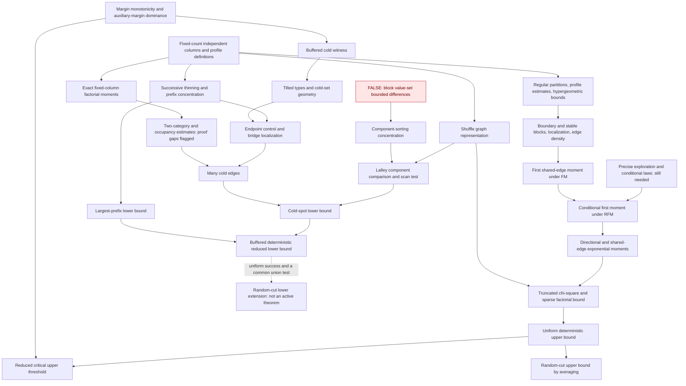

# Proof-recovery audit: mathematical obstruction identified

**Whole-file clarification.** The user's follow-up asked that the intended result be inferred from the complete article. That review identifies **lem:permutation-bd**, component-sorting ascent concentration, as the source-level recovery target: the false general helper has exactly one use, in its proof. See [the exact contextual interpretation](INTENDED_RESULT.md), including its finite meaning, role in the final lower bound, and two reconstruction routes. This supersedes the earlier inability to identify a mathematical target; it does not identify an existing blocked Lean declaration or turn the false helper into a valid theorem.

The three independent reviews have been compared. All three found that the active `lem:block-bd` is false under its stated assumptions. Its use in the cold-spot lower-bound proof is therefore blocked for mathematical reasons. This does **not** establish that the specialized component-concentration theorem or the final lower-bound theorem is false.

This recovery task has written, modified, and tested no Lean proof. The requested blocked Lean declaration was not supplied. The initial inventory found no project `.lean` files outside the bundled tooling; a subsequent authoritative check found newly appearing project files. The latest read-only snapshot, `current_lean_inventory.json`, records 37 files and 616 declarations. These include finite probability, fixed-column moments, sorting, prefix trees, boundary/stopping constructions and scalar first-moment estimates. None was marked as the requested blocked declaration. Their appearance invalidates the earlier absence observation; it does not identify the target or certify any build. The user asked us to wait for the independent reviews; those reviews are complete. We have not silently selected a different theorem as the target.

The source statements and assumptions have been preserved exactly. `SOURCE_CONTRACT.json` records SHA-256 hashes of the three authorized sources, the audit status, and the fact that an implementation freeze remains pending identification of the target. `source_statement_inventory.json` preserves the literal statements, including those in comments. Recording a false statement is not treating it as a proved theorem or adding it as an assumption.

## Deliverables

- [Complete dependency inventory](DEPENDENCIES.md): all 70 active named statements and 14 groups of inline definitions; 84 nodes and 227 directed edges. The reconstructed graph was checked for cycles.
- [Machine-readable dependency graph](dependency_graph.json), including a checked topological order.
- [Literal source-statement inventory](source_statement_inventory.json): 70 active statements and 11 commented-out statements, with source line numbers.
- [Source contract and hashes](SOURCE_CONTRACT.json).
- [Exact finite counterexample checks](exact_checks.json). These are rational-arithmetic checks, **not Lean tests**.
- [Current Lean-source inventory](current_lean_inventory.json) and [requirement-by-requirement completion audit](COMPLETION_AUDIT.md).
- Independent reports: [mathematical reconstruction](reviews/mathematical_reconstruction.md), [Lean encoding](reviews/lean_encoding_review.md), and [hypothesis/falsity audit](reviews/hypothesis_adversary.md).

## Whole-proof structure



This is an architecture diagram, not a certification of all its mathematical arrows. The full inventory identifies individual lemmas and their audit status. In particular, the upper exploration sketches have missing formal definitions, and the lower occupancy proof has separate errors described below.

The manuscript's lines 2562–2785 are inside a `comment` environment. They contain the old lower-bound overview and its random-pile-size blueprint. The active lower proof begins at line 2788. The active random upper corollary is at line 1999; the active final lower theorem is deterministic and buffered.

## Exact mathematical obstruction

Source: `time_inhomogeneous_riffle_shuffle_unified_article.tex`, `lem:block-bd`, lines 4951–4977.

The statement takes a uniform partition of `[N]` into fixed-size disjoint value sets `V₁,…,Vₘ` and a reservoir `V₀`. It assumes that, after fixing every other relevant block, changing `Vⱼ` while adjusting only the reservoir changes `f` by at most `Lⱼ`. It concludes

\[
\mathbb P(|f-\mathbb Ef|\ge t)
\le 2\exp\!\left(-\frac{2t^2}{\sum_j L_j^2}\right).
\]

Take `N=2`, two singleton relevant blocks, and an empty reservoir. There are two equally likely partitions. Set

\[
f=10\mathbf 1_{\{V_1=\{1\}\}},\qquad L_1=L_2=1,\qquad t=5.
\]

Fixing either block determines the other, so the prescribed coordinate oscillations are zero. The hypothesis therefore holds with both positive constants equal to one. But

\[
\mathbb Ef=5,\qquad
\mathbb P(|f-5|\ge5)=1,
\qquad
2e^{-25}<1.
\]

The exponential comparison needs no numerical approximation: `exp(25) ≥ 26`, so `2 exp(-25) ≤ 1/13`.

The obstruction persists with a nonempty reservoir and strictly positive oscillation bounds. Take `N=4`, sizes `(2,1,1)` for `(V₁,V₂,V₀)`, and `f=|V₁∩{1,2}|`. Exhausting all 12 ordered partitions gives

\[
\mathbb Ef=1,\quad
\mathbb P(|f-1|\ge1)=\frac13,\quad
\operatorname{osc}_1(f)=1,\quad \operatorname{osc}_2(f)=0.
\]

Thus `L₁=1,L₂=1/4,t=1` satisfy the stated hypothesis, but the asserted bound is

\[
2e^{-32/17}<\frac13.
\]

For an exact comparison, the sum of the first six nonnegative terms of the exponential series at `32/17` is `138130079/21297855 > 6`. Consequently `exp(32/17)>6`. The finite probabilities and coordinate oscillations were checked using exact rational arithmetic.

The failed dependency is the assertion at lines 4971–4976 that the coordinate hypothesis bounds the range of each conditional Doob expectation. Fixing **all other blocks** is different from conditioning on **previously exposed blocks**. A coupling of the latter can change other relevant blocks, which the hypothesis does not control. In the `N=4` example the first conditional expectation has range two, although the stated first-coordinate oscillation is one.

The affected chain is

```text
lem:block-bd  [false]
  -> lem:permutation-bd
  -> lem:lalley-comparison
  -> lem:lalley
  -> prop:cold-lower
  -> thm:buffered-reduced-lower-bound.
```

This source node is located precisely. It has not been identified with a user-provided Lean declaration, because no such declaration was available. No change of Lean encoding or library lemma can prove the false general statement with its assumptions unchanged.

## Comparison of independent reports

| Finding | Reconstruction | Encoding review | Hypothesis audit | Resolution |
|---|---|---|---|---|
| `lem:block-bd` is false | Independent two-outcome example | Independent two-outcome example | Independent positive-reservoir example | Confirmed; stop any affirmative proof of this exact statement |
| Specialized component concentration may bypass it | Finite-counting and independent-key proofs | Same two encodings with explicit interfaces | Independent-key alternative | Candidate replacement dependencies, not proved Lean lemmas |
| Third factorial Bonferroni coefficient is wrong | Confirmed | Confirmed | Confirmed inside fixed-column model | False proof inequality; not a counterexample to the final occupancy statement |
| Central-window proof lacks error/remainder estimates | Confirmed | No independent detailed audit | Confirmed | Missing proof estimates; theorem not declared false |
| Upper exploration is underspecified | Confirmed | Confirmed | Confirmed | Exact filtration and conditional-law constructions required |
| Random lower extension is only in the commented overview | Confirmed | Confirmed | Confirmed | Must not claim it is already an active proved theorem |

The initial mathematical findings were obtained independently. The reports were compared before any Lean writing. Their final reports also record proposed repairs; these proposals have not been installed into the source contract.

## Two possible proof strategies for the narrower concentration theorem

The following are for `lem:permutation-bd`, not proofs of `lem:block-bd` and not a silent substitution for the unspecified target. Both preserve the stated deterministic graph, deterministic set `H`, reference size `M`, and uniform-permutation assumptions.

1. **Direct finite counting.** Enumerate the path components from left to right. Internal edges are deterministic ascents after sorting. Each remaining comparison depends on the relative order of the values on two neighboring components. Color these boundaries by parity of the **component index**. Within each color, the involved pairs of components are disjoint. Count full permutations realizing prescribed relative orders on disjoint sets: the count is `N! / ∏ aᵢ!`. This proves independence of the indicators within each color. Apply the appropriate independent-sum tail bound to each color and combine them. The number of relevant boundaries is at most `|H|≤M`.

2. **Abstract independent-coordinate representation.** Construct a uniform permutation as the ranks of independent atomless keys. Prove uniformity of the rank law and invariance of all relevant comparisons under ranking. Group the keys by graph component, obtaining independent vectors. Changing one vector changes at most two boundary ascent indicators. A proved bounded-differences theorem for independent coordinates then gives the required scale `M`. Independence is proved for this representation; it is not added as an assumption about the original random value-set partition.

Neither strategy has been implemented or compiler-tested. A successful finite enumeration of counterexamples is not a Lean proof of either strategy. The correct next implementation target depends on which theorem the user intended.

If the intended target is `lem:block-bd`, the exact statement is impossible and recovery must stop. If it is `lem:permutation-bd`, a new freeze should identify that unchanged theorem and the precise finite or measure-theoretic interfaces for these two routes before code is written.

## Other confirmed errors and missing dependencies

The two-category proof at lines 4571–4576 and 4683–4690 uses

\[
\tfrac12\mathbb E(X)_2-\tfrac16\mathbb E(X)_3
\le\mathbb P(X\ge2).
\]

This fails already at the pointwise value `X=3`. It also fails in the actual shuffle model: for `N=8`, three independent balanced columns and the word `000`, exact enumeration of 4,900 equally likely outcomes after fixing the first zero-pile gives

\[
\mathbb EX=1,\quad
\mathbb E(X)_2=27/49,\quad
\mathbb E(X)_3=6/49,
\]

so the claimed lower bound is `25/98 = 1250/4900`, while the actual probability is `1153/4900`. The valid two-term coefficient is `−1/3`, not `−1/6`. This identifies a proof error without changing any final theorem statement.

Further proof obligations, rather than established counterexamples to their conclusions, are:

- The central-window factorial comparison needs a bound on the expected truncated polynomial on the tail, and must account for the logarithmic factors in its error estimate. Its displayed small-o assumption does not automatically absorb them.
- The fixed-mesh tilted type estimates require explicit control of the `O(χ)` replacement error; it cannot silently become `o_N(1)` when `χ` is held fixed before the final limit.
- The ascent expectation proof must retain the internal edges of long clipped components and discard only the bounded number of boundary comparison edges. The number of clipped components does not bound their total size.
- The upper proof needs a precise exploration state space, filtration, regular event, accessible-block definition and conditional residual law before its conditional first-moment statement can be formalized.
- Measurability/integrability of the time profile and the exact parameter quantifiers have not been supplied as a complete Lean-ready interface. They must be resolved explicitly, not silently added.

## Random-pile-size extension

The upper extension uses uniform conditional upper bounds and convexity of total variation. For lower bounds, averaging conditional TV distances is insufficient: mixtures of singular distributions can be uniform.

The required lower construction is a single test, the union of the deterministic tests for all typical integer cut arrays and their translations. There are at most `(N+1)^(kK)` cut arrays. With `K=O(log N)`, a uniform null bound `exp(−N^c)` survives this union and the extra `N+1` translates. Uniform conditional success then gives success under the random-cut mixture. These uniform estimates must be proved after repairing the deterministic cold branch.

This architecture is supported by the two permitted PDFs: `2510.22783v1.pdf`, Proposition 2.2 (PDF page 8), Lemmas 6.3–6.6 (pages 52–53), and `2103.05068v3.pdf`, Proposition 2.2 (page 6), Lemmas 3.1/3.3 (pages 10–11), Proposition 6.1 (page 37). No fourth mathematical source was consulted. The PDFs were read through fresh page-marked text extractions; the full independent reports provide further exact anchors.

## Verification and stop status

- All three independent reports completed and were compared.
- Every active named statement appears once in the semantic dependency graph; all graph references resolve and the graph is acyclic.
- The two partition counterexamples and the fixed-column Bonferroni example were checked exactly.
- No original source, assumption, definition, conclusion or constant was edited.
- No Lean source was written, no Lean proof was tested, and no additional theorem, axiom or placeholder was introduced.
- The mathematical obstruction is definite. An API or encoding diagnosis of the actual blocked Lean goal remains unavailable without its declaration and goal state.

The affirmative recovery is stopped at the false helper rather than claiming a proof or changing its assumptions. The requested two Lean implementations remain unperformed; the proposed narrower target must not be confused with the original, unidentified blocked theorem.
